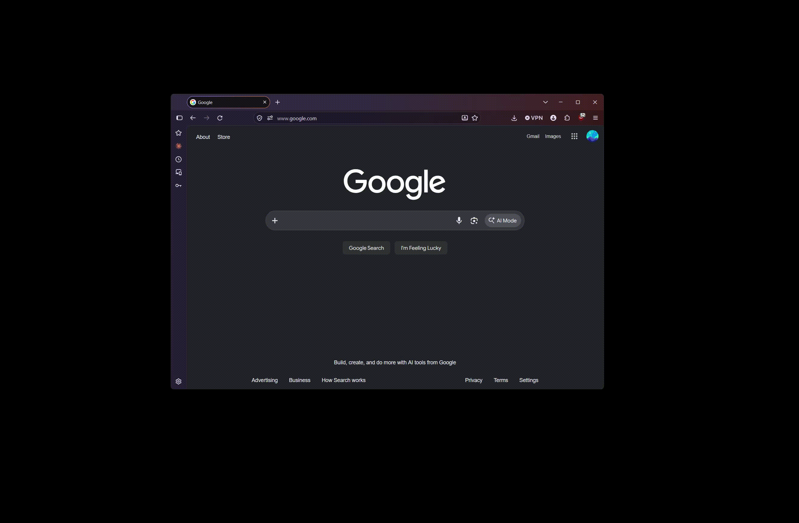
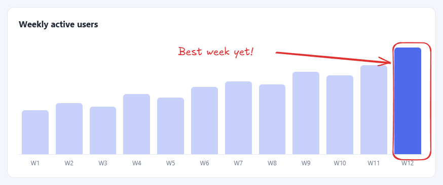
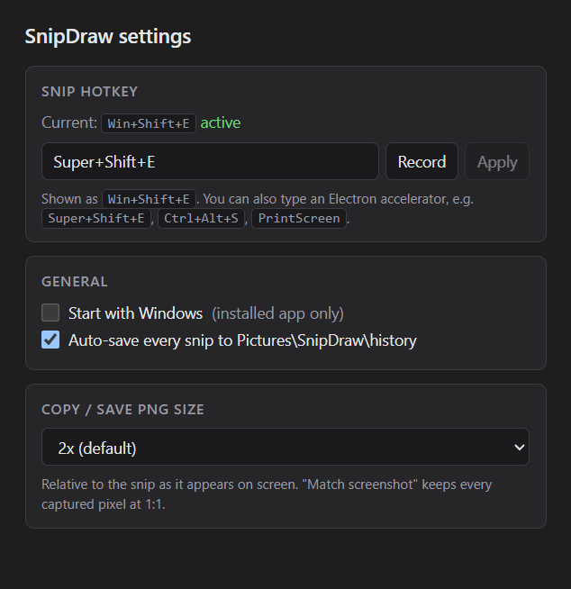

# SnipDraw

Snip any region of your screen with a global hotkey and annotate it right away in an embedded
[Excalidraw](https://github.com/excalidraw/excalidraw) editor. Copy the result to the clipboard, or save it as PNG
or `.excalidraw`. For **Windows** and **macOS**. Think Snipping Tool or the macOS screenshot tool, with a full
whiteboard editor attached.

Here it is on Windows 11:



1. **Press Win+Shift+E** anywhere. Every monitor freezes under a dimmed overlay.
2. **Drag over the part you want**, or click to take the whole screen.
3. **The editor pops up with your snip**, ready to annotate. Draw, type, highlight: it's a full Excalidraw canvas.

**Copy or save.** Press Ctrl+C (⌘C on a Mac) and the annotated image is on your clipboard, exactly as it
looked in the editor:



- Lives in the system tray (Windows) or menu bar (macOS). No window at launch.
- **Win+Shift+E** on Windows or **⇧⌘E** on macOS (configurable) freezes every monitor under a dimmed overlay. Drag
  to select a region, or click once to take the whole screen. **Esc** or right-click cancels.
- The editor opens straight away, centered on the monitor you snipped, with the snip on the canvas and the
  Selection tool active. The snip is shown in its true colors, exactly as it will be copied or saved.
- **Copy** (Ctrl+C / ⌘C, or Ctrl+Enter / ⌘↩) puts a PNG on the clipboard and closes the editor. While you type
  in a text box, Ctrl+C / ⌘C copies the text as usual. **Save** (Ctrl+S / ⌘S) saves a PNG, and Ctrl+Shift+S / ⇧⌘S
  saves an `.excalidraw` scene. **Esc** closes the editor and asks first if you have unsaved annotations.
- Every raw snip is also saved to `Pictures/SnipDraw/history` (you can turn this off in Settings).
- Works fully offline. Excalidraw and its fonts are bundled, and the app blocks all network requests.

## Download

Get the latest version from the [Releases page](https://github.com/HB2310/SnipDraw/releases/latest):

| Platform | File |
| --- | --- |
| Windows 10/11 (x64) | `SnipDraw-Setup-<version>.exe` |
| macOS 12+ (Apple Silicon and Intel) | `SnipDraw-<version>-mac.dmg` |

The builds aren't code-signed by a paid certificate, so each OS asks you to confirm the first launch.

**Windows:** if SmartScreen says "Windows protected your PC", click **More info → Run anyway**.

**macOS:**

1. Open the DMG and drag SnipDraw to Applications.
2. Open SnipDraw. macOS will say it can't verify the developer. Go to **System Settings → Privacy & Security**,
   scroll down, and click **Open Anyway** next to the SnipDraw message. (On macOS 14 and earlier you can also
   right-click the app in Finder and choose **Open**.)
3. The first time you snip, macOS asks for **Screen Recording** permission. Turn SnipDraw on under **System
   Settings → Privacy & Security → Screen & System Audio Recording**, then quit and reopen SnipDraw. SnipDraw
   shows a dialog with a shortcut to that page. Without this permission, macOS only lets SnipDraw capture your
   wallpaper.

Because the Mac build is ad-hoc signed, macOS may ask for Screen Recording permission again after you install an
update.

## Changing the hotkey



Open **Settings…** from the tray or menu-bar icon. Under **Snip hotkey**, either:

- click **Record** and press the combination you want, or
- type an [Electron accelerator](https://www.electronjs.org/docs/latest/api/accelerator) such as `Ctrl+Alt+S`,
  `Super+Shift+S` (Windows), `Command+Shift+S` (macOS) or `F13`,

then click **Apply**. If the OS or another app already owns that shortcut, you'll see an error and the old one
stays active. If the saved hotkey can't be registered at startup, SnipDraw shows a notification. You can still
snip from the tray or menu-bar icon (**Snip now**; on Windows, left-clicking the tray icon also snips).

Settings are stored in `config.json` in the app's data folder:

- Windows: `%APPDATA%\SnipDraw\config.json`
- macOS: `~/Library/Application Support/SnipDraw/config.json`

Dev builds use a separate `SnipDraw-dev` folder, so they can run next to an installed copy. You can edit the file
while the app isn't running:

```json
{ "hotkey": "Super+Shift+E", "autoSaveHistory": true, "exportScale": 2 }
```

`exportScale` controls the size of the copied/saved PNG relative to how the snip looks on screen: `1`, `2`
(default), `3`, or `"native"`. `"native"` keeps every captured pixel at 1:1, so the output is exactly as large as
the region you selected.

On Windows, `PrintScreen` only works if you turn off **Settings → Accessibility → Keyboard → "Use the Print screen
key to open screen capture"**, because Windows reserves the key for Snipping Tool otherwise. On macOS, avoid
⇧⌘3/4/5, which belong to the built-in screenshot tool.

## Building from source

Requires Node.js 20+ (CI uses Node 22).

```bash
npm install
```

If npm says Electron's install script was skipped (npm 11 `allow-scripts`), download the Electron binary once
with:

```bash
node node_modules/electron/install.js
```

Then start the app in development mode (Vite plus Electron, with hot reload for the renderer):

```bash
npm run dev
```

### Tests

```bash
npm run typecheck
```

```bash
npm test
```

`npm test` runs the unit tests for the multi-monitor and DPI math, the hotkey recorder, the pixel conversion and
the dark-theme CSS.

There is also an end-to-end self-test. It drives the real app with synthetic mouse and keyboard input on every
connected display: capture → overlay → drag → crop → editor → Copy → clipboard. It checks pixel by pixel that:

- the overlay dims everything outside the selection,
- the crop and the editor show the captured pixels unchanged,
- the clipboard image matches the crop.

It also checks that Esc and right-click cancel and that no network requests were made. It flashes the overlay on
your screens for a few seconds, and it saves your clipboard and restores it afterwards.

```bash
SNIPDRAW_SELFTEST=1 SNIPDRAW_SELFTEST_OUT=./selftest-out npm run dev
```

In PowerShell:

```powershell
$env:SNIPDRAW_SELFTEST=1; $env:SNIPDRAW_SELFTEST_OUT="$env:TEMP\snipdraw-selftest"; npm run dev
```

To test the production bundle (app:// protocol and strict CSP), run `npm run build` and then
`npx electron-vite preview --skipBuild` instead of `npm run dev`. Results are in `report.json` in the output
folder, next to screenshots of the overlay, editor, crop and clipboard. CI also runs this test on GitHub's
Windows and macOS runners and uploads the report as an artifact.

### Screenshots

The demo GIF at the top (`docs/screenshots/demo.gif`) was recorded by hand on a real Windows desktop. The
annotated export and the Settings image come from a dev-only script that drives the real app. The script stages a
neutral demo desktop on one monitor (a wallpaper plus two fictional app windows from `docs/screenshot-demo/`), snips
part of a window, draws annotations with synthetic input, copies the result and opens Settings. It writes
`overlay.png`, `editor.png`, `result.png` and `settings.png` to `docs/screenshots/`. Quit any installed SnipDraw
first (it would hold the hotkey), keep your hands off the mouse for about 20 seconds, then run:

```bash
npm run build
```

```bash
SNIPDRAW_SCREENSHOTS=1 npx electron-vite preview --skipBuild
```

It prefers a 16:9 monitor at 100% scaling. Set `SNIPDRAW_SCREENSHOT_DISPLAY=<display id>` to choose a different one.

### Packaging

```bash
npm run dist
```

```bash
npm run dist:mac
```

`npm run dist` builds `dist/SnipDraw-Setup-<version>.exe` and must run on Windows. `npm run dist:mac` builds a
universal `dist/SnipDraw-<version>-mac.dmg` and must run on a Mac. `npm run icon` regenerates the icons in
`resources/`.

> **Windows long paths:** NSIS can't open files whose full path is over 260 characters. If `npm run dist` fails
> with `!include: could not open file ...`, move the project to a shorter folder (e.g. `C:\dev\snipdraw`).

### Releasing

Set `"version"` in `package.json`, commit, then push a matching tag:

```bash
git tag v0.2.0
```

```bash
git push origin v0.2.0
```

The [Release workflow](.github/workflows/release.yml) builds both platforms and uploads them to a draft GitHub
release. Review it, add notes, and publish.

## How it works

```
src/
  main/            Electron main process
    index.ts         app lifecycle, single-instance lock, settings IPC, tray wiring
    hotkey.ts        global shortcut (with rollback if a new one can't be registered)
    capture.ts       desktopCapturer at native resolution for every display
    permissions.ts   macOS Screen Recording permission check
    overlay.ts       one pre-created transparent overlay window per display
    snip.ts          hotkey → capture → overlay → crop → editor flow
    editor.ts        the pre-loaded hidden editor window, clipboard + save dialog
    security.ts      app:// protocol for the built renderer, network lock-down
    selftest.ts      dev-only end-to-end test (excluded from the installer)
  preload/         contextBridge API (contextIsolation on, nodeIntegration off, sandboxed)
  renderer/        three Vite entries: overlay.html, editor.html, settings.html
  shared/          pure, unit-tested geometry / accelerator / pixel / dark-theme CSS helpers
```

**Fast editor.** The editor window and the overlay windows are created hidden at startup with their pages
already loaded. A snip only has to push pixels and call `show()`. The editor is shown as soon as the snip's real
pixels are on the canvas, never on Excalidraw's loading placeholder. On the dev machine that took 40–80 ms after
mouse-up.

**True colors in a dark editor.** Excalidraw's dark theme draws the whole canvas through an
`invert(93%) hue-rotate(180deg)` filter and pre-filters images to roughly cancel it out. That made screenshots
look off (white became #ededed, colors shifted), and annotation colors differed between the editor and the PNG.
So the canvas runs in Excalidraw's light mode (no filters), and the dark toolbars and panels are re-applied by
copying Excalidraw's own dark-theme CSS rules (`src/shared/dark-chrome.ts`). What you see in the editor is
pixel-for-pixel what Copy and Save produce.

**Multi-monitor and mixed DPI (Windows).** Electron reports display sizes in DIPs, and Chromium rounds them with
an *enclosing* rectangle. So `display.size × scaleFactor` is often off by one pixel. Some examples:

- A 1440×2560 portrait monitor at 125% is reported as 2049 DIP tall, which gives 2561 px.
- A 2560×1600 laptop at 150% is reported as 1707×1067 DIP, which gives 2561×1601 px.

`desktopCapturer` scales every capture to fit `thumbnailSize`, so asking for one pixel too many resamples the
whole screenshot. SnipDraw instead reads each display's exact physical origin (`screen.dipToScreenPoint`) and
inverts Chromium's rounding to get the true pixel size (`src/shared/geometry.ts`, `nativeSize`). It makes one
`getSources` call per distinct size, run in parallel. macOS uses integer backing scales (1x/2x), so there the
plain product is exact.

The overlay draws the frozen capture at one bitmap pixel per device pixel, from the window origin. Selections map
to capture pixels through `devicePixelRatio`. So the crop is exact even when Windows makes an overlay window a
pixel larger than its monitor.

## Known limitations

- **macOS support is new.** On GitHub's Mac runners, the self-test's capture, overlay, crop, editor and copy
  checks all pass, pixel-exact, but the app hasn't had much real-world use on Macs yet. Bug reports are very welcome.
- **DRM-protected video** (Netflix, Disney+, some browsers' protected playback) shows up black in captures. The
  OS and GPU driver enforce this.
- **Exclusive-fullscreen games** on Windows (true fullscreen, not borderless/windowed-fullscreen) may minimize or
  flicker when the overlay appears, or capture black. Borderless and windowed-fullscreen games work.
- **Capture latency:** the OS screen capture takes a few hundred milliseconds (about 350–450 ms on the Windows dev
  machine), so the frozen overlay appears shortly after the hotkey. Anything that changes on screen in that window
  is in the snip.
- **One display per snip:** a selection can't span two monitors. Drag on the monitor you want, or click it to
  snip that whole screen.
- **New snip replaces the editor:** taking a new snip while the editor has unsaved annotations replaces them
  without asking. The raw snip is still in the history folder.
- **Start with Windows / Open at Login** is only available in the installed app. In `npm run dev` it would
  register the bare Electron binary.

## License

[MIT](LICENSE) © Hyder Baig. Bundled third-party components and fonts are listed in
[THIRD_PARTY_NOTICES.md](THIRD_PARTY_NOTICES.md). SnipDraw is not affiliated with the Excalidraw project.
